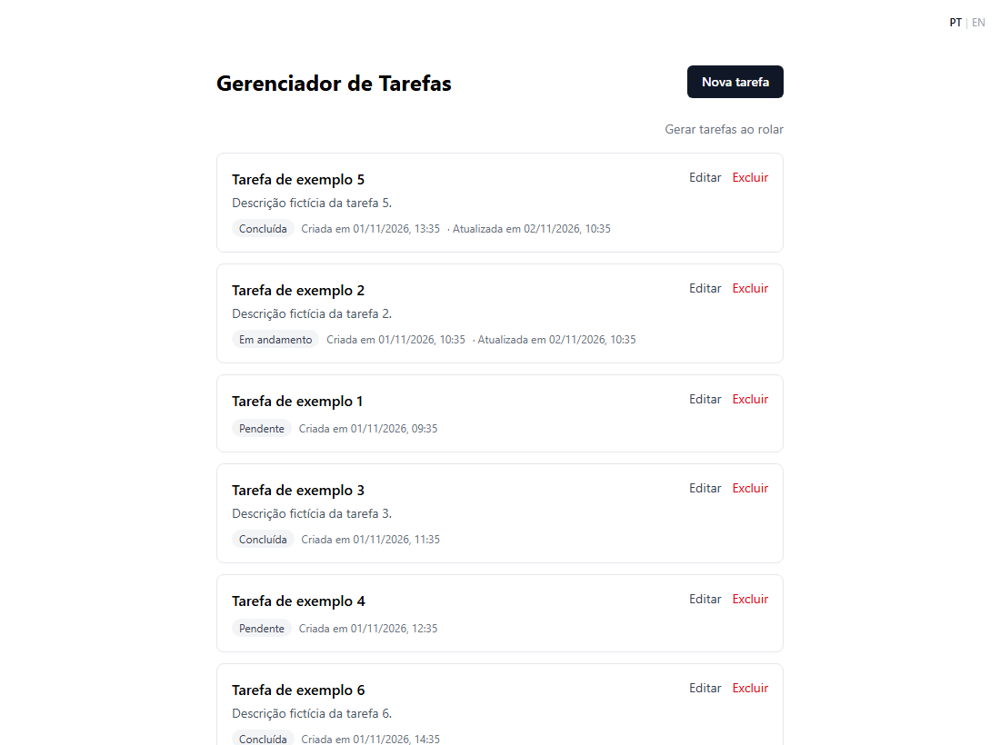
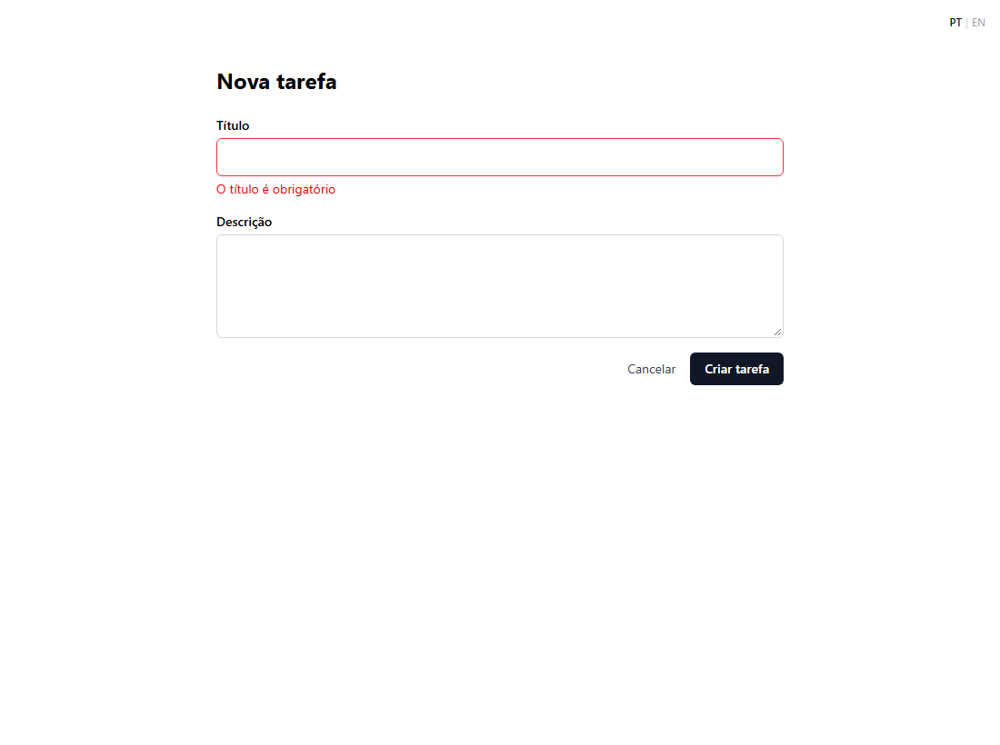
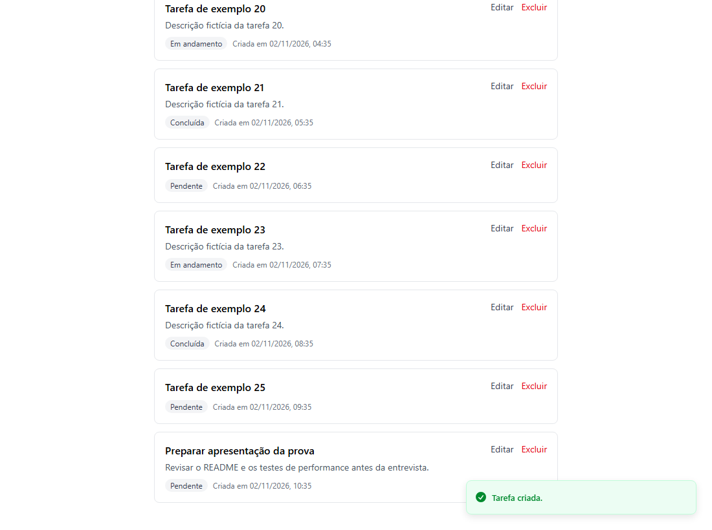
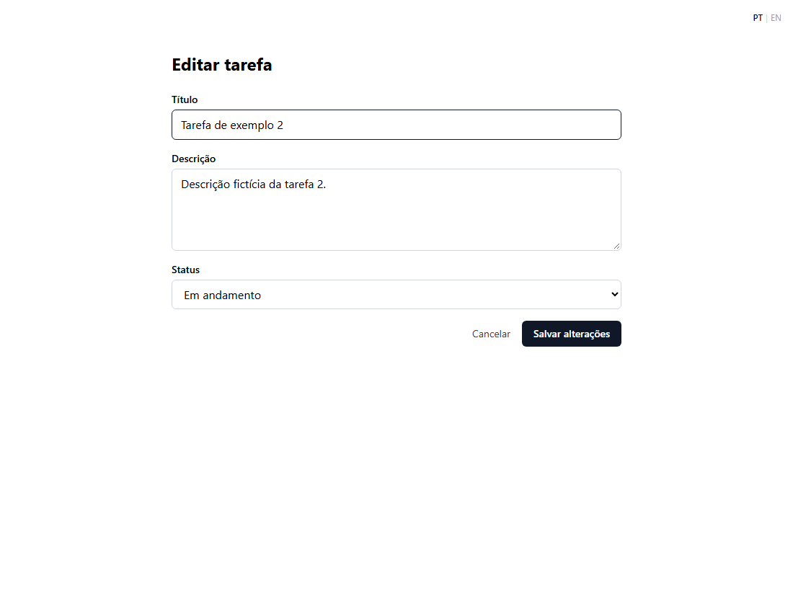
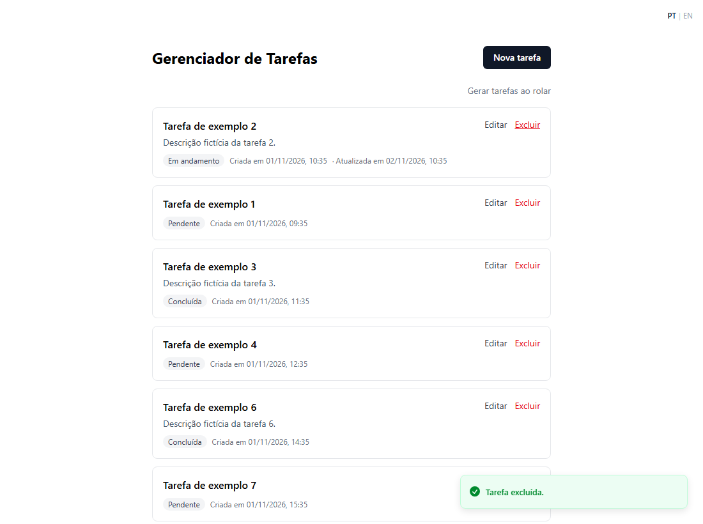
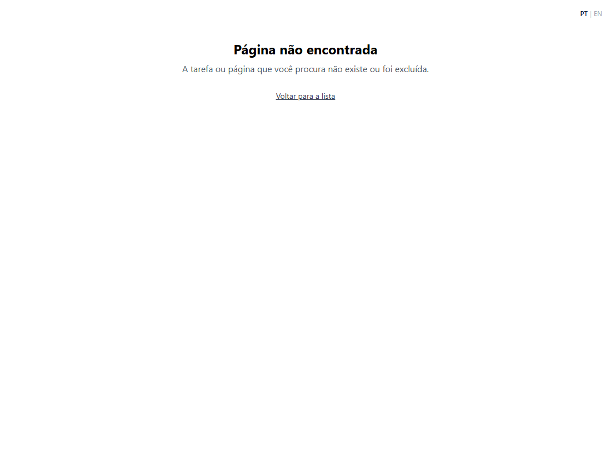
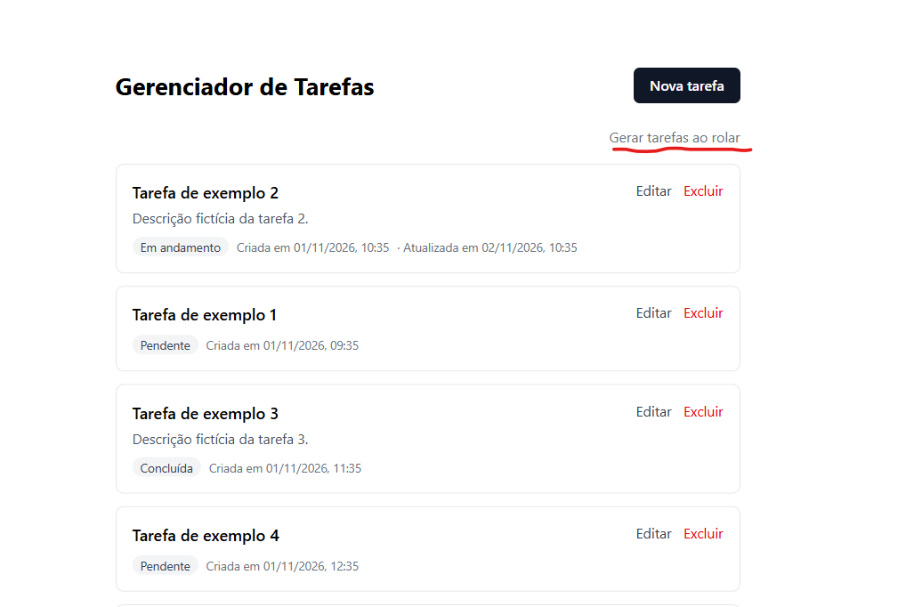
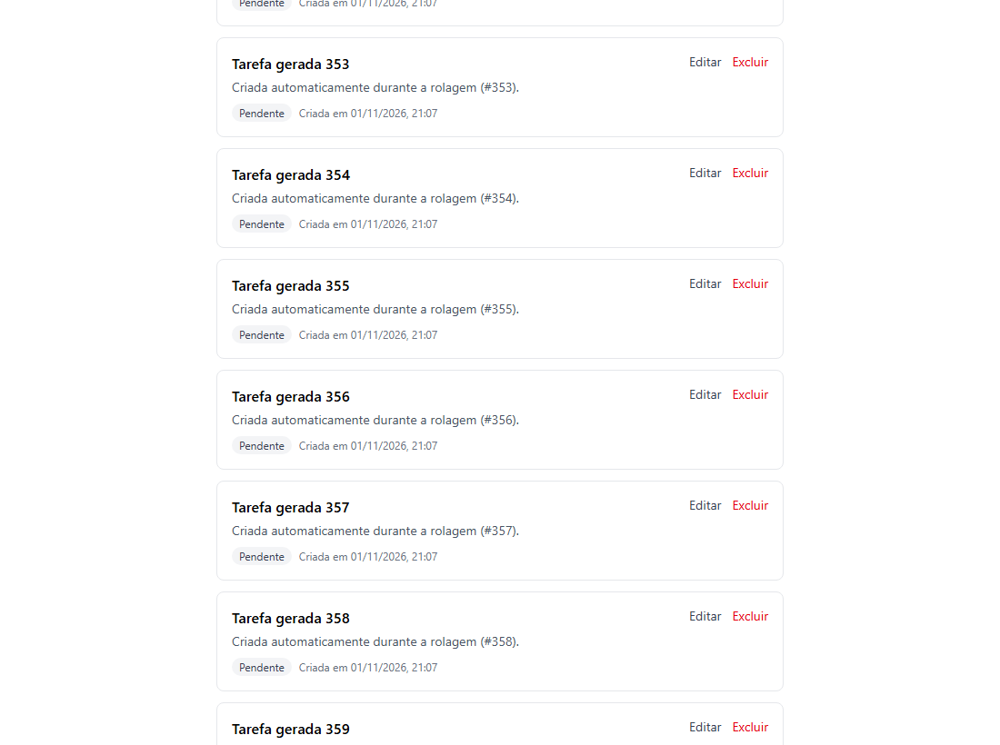

# Task Manager

Task CRUD built with **Next.js 15 (App Router)** and **tRPC v11**: in-memory storage, server-rendered task list (SSR), form validation and a Portuguese/English interface. It also includes a scroll performance study, with measurements on the server and in the browser ([see below](#scroll-performance-study)).



## Running

### With Docker (recommended)

Requirement: Docker with Docker Compose.

```bash
docker compose up -d --build
```

Open **http://localhost:3000**. To stop: `docker compose down`.

The app starts with 25 sample tasks. Data lives in memory only and is **not persisted**: restarting the container wipes everything and recreates the samples.

### Without Docker (development)

Requirement: Node.js 22.

```bash
npm install
SEED_DEMO_DATA=true npm run dev                 # bash
$env:SEED_DEMO_DATA="true"; npm run dev         # PowerShell
```

### Environment variables

Already set in `docker-compose.yml`:

| Variable | Compose value | Purpose |
|---|---|---|
| `SEED_DEMO_DATA` | `true` | Creates 25 sample tasks on startup |
| `METRICS_INTERVAL_MS` | `10000` | Interval of the metrics summary in the log |

## Features

| | |
|---|---|
| **SSR list**: the first page is already in the HTML | **Validation** on client and server, with a message per field |
|  |  |
| **Create** with confirmation; the new task shows up at the top of the list | **Edit** title, description and status |
|  |  |
| **Delete** with confirmation and a success or error notice | **Missing task**: 404 page |
|  |  |

The list shows tasks created or edited by the user first (most recent change on top), then the sample tasks and the ones generated while scrolling, oldest first. The interface is available in Portuguese (default) and English, with a PT | EN switch in the top-right corner. The screenshots show the Portuguese version.

## Infinite scroll (bonus)

The list loads 10 tasks at a time as the page scrolls, covering the infinite scroll bonus. Pagination is cursor-based, and the first page is already rendered by the server.

To test scrolling with volume, there is a mode that creates tasks on the server while the page scrolls: `/?mode=generate` (link "Generate tasks on scroll").

| "Generate tasks on scroll" link | Tasks being created while scrolling |
|---|---|
|  |  |

### Scroll performance study

To check whether the infinite scroll holds up with volume, I built the generate mode above. Testing with it, I noticed scrolling got slower as the list grew. Instead of optimizing on intuition, I measured where the bottleneck was:

- **Server** (`npm run test:stress`): 100,000 tasks created and read through the API, with responses in a few milliseconds from start to finish. The server was not the bottleneck.
- **Browser** (`npm run test:perf`): Playwright scrolling the page and measuring pace, DOM size, memory and blocked time. The bottleneck was here: with every task in the DOM, the page spent most of its time blocked from ~2,000 tasks on.

| | Without virtualization | With virtualization (adopted) |
|---|---|---|
| Reaching 10,000 tasks | did not reach it in 5 min (stopped at 7,545) | **90 s** |
| Items in the DOM | thousands | **~18** |
| Peak browser memory | 430 MB | **58 MB** |
| Blocked time (~7,000 tasks) | 75–88 % | **≤ 11 %** |

The fix was to virtualize the list with `@tanstack/react-virtual`, which keeps only the visible tasks in the DOM. Methodology, per-window data and the known limitation are in [test/README.md](test/README.md).

## How it works

```
Browser                                     Server (Next.js)
───────                                     ────────────────
Pages (React)                               Server Components (SSR)
  │  React Query (cache)                      │  fetches the 1st page before rendering
  │  tRPC client ──── HTTP /api/trpc ───────▶ │  tRPC router (task.*)
  │                                           │    ├─ validation (Zod)
  │                                           │    └─ metrics middleware
  │                                           ▼
  │                                         Task repository
  │                                           └─ in-memory storage (Map)
```

### Request flow

1. The page is a **Server Component**: on the server it fetches the first page of tasks and delivers ready HTML. The cache arrives prefilled in the browser (hydration), with no second request.
2. In the browser, actions (create, edit, delete, load more) use the **tRPC client** on top of **React Query**: end-to-end types, caching, loading and error states.
3. On the server, each procedure validates its input with **Zod** (the same schemas as the form) and calls the **repository**.
4. Errors come back as **codes** (e.g. `NOT_FOUND`, `titleRequired`); the frontend translates them into the user's language.

### API (tRPC)

| Procedure | Type | Description |
|---|---|---|
| `task.list` | query | Cursor-paginated list with configurable ordering |
| `task.byId` | query | Fetches one task |
| `task.create` | mutation | Creates a task (title required, up to 100 characters; optional description, up to 500) |
| `task.update` | mutation | Updates title, description and status |
| `task.delete` | mutation | Deletes a task |
| `task.generateBatch` | mutation | Creates a batch of tasks (generate mode, for demonstration) |

### Data model

The field names follow the challenge spec (`titulo`, `descricao`, `dataCriacao`).

| Field | Type | |
|---|---|---|
| `id` | UUID | generated on the server |
| `titulo` | string | required |
| `descricao` | string? | optional |
| `status` | `pending` \| `in_progress` \| `completed` | extra field |
| `dataCriacao` | Date | |
| `dataAtualizacao` | Date? | extra field; set when the user creates or edits a task (empty for sample and generated tasks) |

`status` and `dataAtualizacao` were not in the spec. Status is a basic part of modeling a task. The update date is needed for ordering: it is what brings a task created or edited by the user to the top of the list. Tasks generated while scrolling don't get it, so they land at the end of the list, where the infinite scroll appends them.

### Storage

Tasks are stored **in memory only** (a `Map` keyed by id), as the spec asks. **There is no persistence**: nothing is written to disk or a database, and all tasks are lost when the server or container restarts. Data access goes through a repository (`src/server/task-repository.ts`). The rest of the app only knows the repository, so swapping in a database would not affect routes or pages. The sorted list is cached and only recomputed when a task is created, edited or deleted.

### Server metrics

Every 10 s with traffic, the server prints a per-endpoint summary to the log (calls, errors, average, p95, max and trend) along with memory usage:

```bash
docker compose logs -f app
```

```
[metrics] 22:26:43 UTC · last 10s · heap 39.9MB/2096.0MB (2%) · rss 139.1MB · tasks 6845
┌────────────────────┬───────┬────────┬───────┬───────┬───────┬───────────┐
│ endpoint           │ calls │ errors │ avg   │ p95   │ max   │ p95 trend │
├────────────────────┼───────┼────────┼───────┼───────┼───────┼───────────┤
│ task.generateBatch │ 153   │ 0      │ 0.4ms │ 0.7ms │ 2.0ms │ █▄▃       │
│ task.list          │ 153   │ 0      │ 1.5ms │ 2.1ms │ 3.3ms │ ▄▆█       │
└────────────────────┴───────┴────────┴───────┴───────┴───────┴───────────┘
```

## Tests

```bash
npm test             # Vitest: API endpoints, ordering and metrics
npm run lint
```

The endpoint tests (`src/server/routers/task.test.ts`) call each tRPC procedure without starting the server, covering create, fetch, edit, delete, pagination, batch generation, validation and errors (`BAD_REQUEST`, `NOT_FOUND`). Two of them go through the HTTP handler to check the error format the form receives. Each test starts with empty storage.

Performance tests (optional, need the app running): see [test/README.md](test/README.md).

## Stack

| | |
|---|---|
| Framework | Next.js 15.5 (App Router, `output: "standalone"`) |
| API | tRPC v11 + `@trpc/tanstack-react-query`, superjson |
| Client data | TanStack React Query, TanStack Virtual |
| Validation | Zod (schemas shared between client and server) |
| Forms | React Hook Form + `@hookform/resolvers` |
| Languages | next-intl (locale in a cookie, no URL prefix) |
| Styling | Tailwind CSS 4 |
| Tests | Vitest; Playwright (performance) |
| Runtime | Docker (multi-stage, non-root user) |

## Structure

```
src/
  app/                  routes: list (/), new (/tasks/new), edit (/tasks/[id]/edit), API (/api/trpc)
  components/           list, item, form, language switch
  schemas/task.ts       Zod schemas and types (single source of the validation rules)
  server/
    routers/task.ts     tRPC procedures
    task-repository.ts  data access (sort, paginate, create, update)
    task-ordering.ts    ordering rule
    metrics*.ts         metrics collection and summary
  trpc/                 tRPC setup on client and server
  i18n/                 language setup
messages/               pt and en texts
test/                   performance tests and analysis
```
