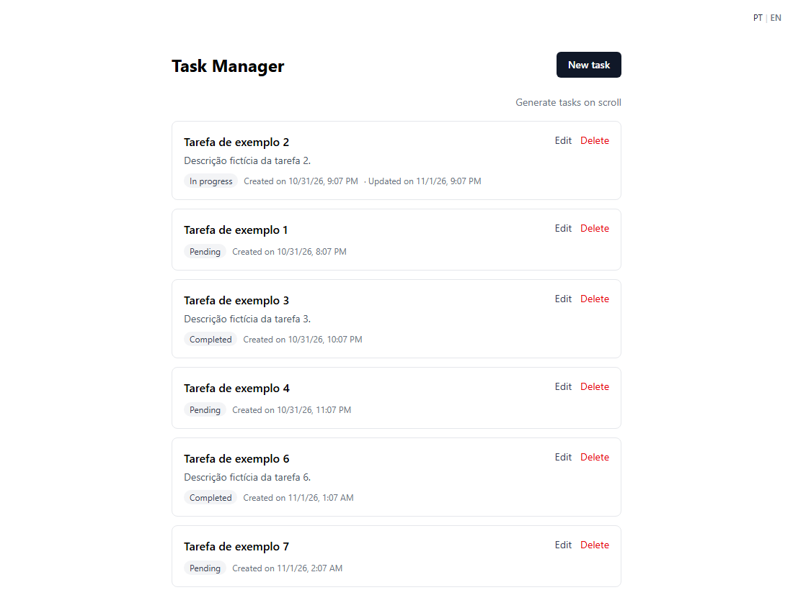

# Gerenciador de Tarefas

CRUD de tarefas com **Next.js 15 (App Router)** e **tRPC v11**, com armazenamento em memória, listagem renderizada no servidor (SSR), formulário com validação e interface em português e inglês.


## Como executar

### Com Docker (recomendado)

Pré-requisito: Docker com Docker Compose.

```bash
docker compose up -d --build
```

Acesse **http://localhost:3000**. Para parar: `docker compose down`.

O app sobe com 25 tarefas de exemplo. Os dados ficam em memória: **reiniciar o container apaga tudo** e recria os exemplos.

### Sem Docker (desenvolvimento)

Pré-requisito: Node.js 22.

```bash
npm install
SEED_DEMO_DATA=true npm run dev                 # bash
$env:SEED_DEMO_DATA="true"; npm run dev         # PowerShell
```

### Variáveis de ambiente

Já configuradas no `docker-compose.yml`:

| Variável | Valor no Compose | Para que serve |
|---|---|---|
| `SEED_DEMO_DATA` | `true` | Cria 25 tarefas de exemplo ao iniciar |
| `METRICS_INTERVAL_MS` | `10000` | Intervalo do resumo de métricas no log |

## Funcionalidades

| | |
|---|---|
| **Listagem com SSR**: a primeira página já vem no HTML; o resto carrega ao rolar (infinite scroll) | **Validação** no cliente e no servidor, com mensagens por campo |
|  |  |
| **Edição** com status (pendente, em andamento, concluída) | **Feedback** de cada ação (toasts) e estados de carregamento |
|  |  |
| **Português e inglês**: seletor PT \| EN no canto superior direito | **Tarefa inexistente**: página 404 amigável |
|  |  |

**Ordenação da lista:** tarefas editadas primeiro (a editada mais recentemente no topo), depois as nunca editadas, da mais antiga para a mais nova.

**Modo geração** (`/?mode=generate`, link "Gerar tarefas ao rolar"): ao rolar até o fim, novas tarefas são criadas no servidor em lotes de 20. Foi usado para testar a aplicação com milhares de tarefas.


## Como funciona

```
Navegador                                   Servidor (Next.js)
─────────                                   ──────────────────
Páginas (React)                             Server Components (SSR)
  │  React Query (cache)                      │  busca a 1ª página antes de renderizar
  │  tRPC client ──── HTTP /api/trpc ───────▶ │  tRPC router (task.*)
  │                                           │    ├─ validação (Zod)
  │                                           │    └─ middleware de métricas
  │                                           ▼
  │                                         Repositório de tarefas
  │                                           └─ armazenamento em memória (Map)
```

### Fluxo de uma requisição

1. A página é um **Server Component**: no servidor, ela busca a primeira página de tarefas e entrega o HTML pronto. O cache já vem preenchido para o navegador (hidratação), sem segunda requisição.
2. No navegador, as ações (criar, editar, excluir, carregar mais) usam o **cliente tRPC** sobre o **React Query**: tipos de ponta a ponta, cache, estados de carregamento e erro.
3. No servidor, cada procedure valida a entrada com **Zod** (os mesmos schemas do formulário) e chama o **repositório**.
4. Erros voltam como **códigos** (ex.: `NOT_FOUND`, `titleRequired`); o frontend traduz para o idioma do usuário.

### API (tRPC)

| Procedure | Tipo | Descrição |
|---|---|---|
| `task.list` | query | Lista paginada por cursor, com ordenação configurável |
| `task.byId` | query | Busca uma tarefa |
| `task.create` | mutation | Cria (título obrigatório, até 100 caracteres; descrição opcional, até 500) |
| `task.update` | mutation | Atualiza título, descrição e status |
| `task.delete` | mutation | Exclui |
| `task.generateBatch` | mutation | Cria um lote de tarefas (modo geração) |

### Modelo de dados

| Campo | Tipo | |
|---|---|---|
| `id` | UUID | gerado no servidor |
| `titulo` | string | obrigatório |
| `descricao` | string? | opcional |
| `status` | `pending` \| `in_progress` \| `completed` | |
| `dataCriacao` | Date | |
| `dataAtualizacao` | Date? | vazia até a primeira edição |

### Armazenamento

As tarefas ficam **em memória** (um `Map` indexado pelo id), como pede o enunciado, atrás de um repositório (`src/server/task-repository.ts`). O resto da aplicação só conhece o repositório, então trocar por um banco de dados não afetaria rotas nem telas. A lista ordenada fica em cache e só é recalculada quando alguma tarefa é criada, editada ou excluída. Um teste de stress com 100 mil tarefas manteve as respostas em poucos milissegundos (ver [test/README.md](test/README.md)).

### Lista virtualizada

A lista renderiza apenas as tarefas visíveis na tela (`@tanstack/react-virtual`), então o custo de exibir 10 ou 10 mil tarefas é o mesmo. A decisão foi tomada com base em testes de performance: ver [test/README.md](test/README.md).

### Métricas no servidor

A cada 10 s com tráfego, o servidor imprime no log um resumo por endpoint (chamadas, erros, média, p95, máximo e tendência) e a memória em uso:

```bash
docker logs -f artefact_ai_engineer-app-1
```

```
[metrics] 22:26:43 UTC · last 10s · heap 39.9MB/2096.0MB (2%) · rss 139.1MB · tasks 6845
┌────────────────────┬───────┬────────┬───────┬───────┬───────┬───────────┐
│ endpoint           │ calls │ errors │ avg   │ p95   │ max   │ p95 trend │
├────────────────────┼───────┼────────┼───────┼───────┼───────┼───────────┤
│ task.generateBatch │ 153   │ 0      │ 0.4ms │ 0.7ms │ 2.0ms │ █▄▃       │
│ task.list          │ 153   │ 0      │ 1.5ms │ 2.1ms │ 3.3ms │ ▄▆█       │
└────────────────────┴───────┴────────┴───────┴───────┴───────┴───────────┘
```

## Testes

```bash
npm test             # testes unitários (Vitest): ordenação e métricas
npm run lint
```

Testes de performance (opcionais, precisam do app no ar): ver [test/README.md](test/README.md).

## Stack

| | |
|---|---|
| Framework | Next.js 15.5 (App Router, `output: "standalone"`) |
| API | tRPC v11 + `@trpc/tanstack-react-query`, superjson |
| Dados no cliente | TanStack React Query, TanStack Virtual |
| Validação | Zod (schemas compartilhados entre cliente e servidor) |
| Formulários | React Hook Form + `@hookform/resolvers` |
| Idiomas | next-intl (idioma em cookie, sem prefixo na URL) |
| Estilo | Tailwind CSS 4 |
| Testes | Vitest; Playwright (performance) |
| Execução | Docker (multi-stage, usuário sem privilégios) |

## Estrutura

```
src/
  app/                  rotas: lista (/), nova (/tasks/new), edição (/tasks/[id]/edit), API (/api/trpc)
  components/           lista, item, formulário, seletor de idioma
  schemas/task.ts       schemas Zod e tipos (fonte única das regras de validação)
  server/
    routers/task.ts     procedures tRPC
    task-repository.ts  regras de acesso aos dados (ordenar, paginar, criar, atualizar)
    task-ordering.ts    regra de ordenação
    metrics*.ts         coleta e resumo das métricas
  trpc/                 configuração do tRPC no cliente e no servidor
  i18n/                 configuração de idiomas
messages/               textos em pt e en
test/                   testes de performance e análise
```
